# Universal MCP Gateway

A local-first, self-hosted gateway and control plane for Model Context Protocol
(MCP) backends and coding agents.

One MCP endpoint in front of many backends. The gateway aggregates their tools
into a single catalog, routes calls, enforces per-agent policies, isolates
sessions, and records every decision in an audit trail. A separate operator
dashboard manages all of it.



## Features

- **One endpoint, many backends.** stdio and Streamable HTTP MCP servers are
  registered at runtime; tools are discovered, namespaced (`backend__tool`), and
  routed from a single catalog.
- **Agents and credentials.** Each agent gets its own bearer token; tokens are
  stored as hashes, can be rotated and revoked, and are shown once at creation.
- **Authorization policies.** Allow/deny rules are evaluated per tool call and
  can be previewed before they are applied.
- **Session isolation.** Every MCP session is bound to the authenticated agent,
  with idle and hard lifetime limits and bounded concurrency.
- **Managed integrations.** Code-registered providers (GitHub, Notion, Slack)
  share the same catalog, policy engine, audit trail, and lifecycle as backends,
  with no provider-specific logic outside their adapter directories.
- **Operation surface.** Structured, correlated logs; Prometheus metrics;
  readiness and liveness probes; bounded graceful shutdown.
- **Operator dashboard.** Overview, backends, tools, agents, policies, sessions,
  activity, audit, integrations, and monitoring — including connect, validate,
  and policy assignment.
- **Backup and restore.** Verified SQLite snapshots and a restore path that
  refuses to run against a live gateway.

## Requirements

- Node.js **26** (matches CI and the container image)
- pnpm **11** (`corepack enable`)
- Linux, macOS, or WSL2. SQLite is embedded — no external database.

## Quick start

```bash
git clone <repository-url> universal-mcp-gateway
cd universal-mcp-gateway
pnpm install

# The gateway refuses to sign MCP credentials without this (≥ 32 chars).
export CREDENTIAL_HASH_SECRET="$(node -e "console.log(require('node:crypto').randomBytes(32).toString('base64url'))")"

# Create the first operator account (interactive; the password is never an argv).
pnpm operator:create

# Terminal 1 — gateway on 127.0.0.1:8787
pnpm dev

# Terminal 2 — dashboard on http://127.0.0.1:3000
pnpm dev:dashboard
```

Open <http://127.0.0.1:3000> and sign in. The dashboard shows "Gateway
unreachable" until the gateway process is up; that is a real state, not an
error.

There is no built-in `.env` loader. `.env.example` documents the variables;
export them in your shell or inject them with your process manager.

### Connect an MCP client

Create an agent and a credential in the dashboard (the token is shown once),
then point the client at the gateway:

```json
{
  "mcpServers": {
    "gateway": {
      "type": "http",
      "url": "http://127.0.0.1:8787/mcp",
      "headers": { "Authorization": "Bearer <agent token>" }
    }
  }
}
```

Verified end-to-end with Claude Code and OpenCode. See
[`docs/AGENT_COMPATIBILITY.md`](docs/AGENT_COMPATIBILITY.md) for the full client
matrix and evidence.

## Configuration

Precedence: explicit overrides → environment variables → defaults. Invalid
values fail fast at startup with a message naming the setting. Secrets are never
logged.

| Variable | Default | Purpose |
| --- | --- | --- |
| `HOST` | `127.0.0.1` | Loopback only (`127.0.0.1`, `localhost`, `::1`) |
| `PORT` | `8787` | Gateway listener port |
| `DATABASE_PATH` | `./data/gateway.db` | Resolved against the repository root, not the working directory |
| `ENVIRONMENT` | `development` | `development`, `test`, `production` |
| `LOG_LEVEL` | `info` | `fatal` … `trace`, `silent` |
| `CREDENTIAL_HASH_SECRET` | *(required)* | ≥ 32 chars; production refuses to start without it |
| `CREDENTIAL_HASH_KEY_ID` | `v1` | Key id stored with each credential digest |
| `INTEGRATION_MASTER_KEY` | *(none)* | 32-byte base64 key for integration credentials; the vault fails closed without it |
| `ALLOW_PRIVATE_NETWORK` | `false` | Permit private/loopback HTTP backends (fixtures only) |
| `REQUEST_TIMEOUT_MS` | `30000` | Bound on one MCP request exchange |
| `TOOL_DISCOVERY_TIMEOUT_MS` | `15000` | Bound on one backend's `tools/list` |
| `TOOL_CALL_TIMEOUT_MS` | `60000` | Ceiling on one `tools/call` |
| `SESSION_IDLE_TIMEOUT_MS` | `1800000` | Idle session refusal window |
| `SESSION_MAX_LIFETIME_MS` | `43200000` | Hard session cap from creation |
| `RECONNECT_ENABLED` | `false` | Automatic reconnect after a transient loss |
| `OPERATOR_SESSION_IDLE_TIMEOUT_MS` | `1800000` | Dashboard session idle timeout |
| `OPERATOR_COOKIE_SECURE` | `false` | Set `true` only when serving the dashboard over HTTPS |
| `GATEWAY_ORIGIN` | `http://127.0.0.1:8787` | Dashboard → gateway address; server-only, never `NEXT_PUBLIC_*` |

The full list, including reconnect backoff and operator session limits, is in
[`.env.example`](.env.example). Every setting is validated at startup.

## Surfaces

| Path | Auth | Purpose |
| --- | --- | --- |
| `ALL /mcp` | Agent bearer token | Authenticated MCP endpoint (Streamable HTTP) |
| `/api/v1/*` | Operator session + CSRF for writes | Management API (backends, agents, policies, sessions, audit, monitoring) |
| `GET /health` | None | Liveness probe |
| `GET /ready` | None | Readiness: 503 when storage or the ledger is unreadable |
| `GET /metrics` | Operator session | Prometheus text export |
| `GET /api/v1/openapi.json` | Operator session | OpenAPI 3.1 contract, checked against the live route table |

Errors share one envelope: `{ "error": { "code", "message", "requestId" } }`.
The endpoint-by-endpoint contract is
[`docs/API_REFERENCE.md`](docs/API_REFERENCE.md).

## Commands

The repository is a pnpm workspace; the root manifest only orchestrates.

| Command | Result |
| --- | --- |
| `pnpm dev` | Gateway with file watching on `127.0.0.1:8787` |
| `pnpm dev:dashboard` | Dashboard on `127.0.0.1:3000` |
| `pnpm build` | Build both applications |
| `pnpm verify` | Both typechecks and both test suites (the gate) |
| `pnpm soak --profile=ci` | 90-second steady-load measurement (CI only) |
| `pnpm operator:create` | Create the first operator account |
| `pnpm operator:unlock <name>` | Clear a 15-minute lockout after failed sign-ins |
| `pnpm backup` | Verified snapshot of a running gateway |
| `pnpm restore <file> --confirm` | Restore with the gateway stopped |

## Project layout

| Path | Contents |
| --- | --- |
| `apps/gateway` | Gateway: Hono HTTP layer, MCP routing, adapters, policies, SQLite store, CLIs |
| `apps/dashboard` | Next.js operator dashboard (React, Astryx design system) |
| `deployment/` | Docker and systemd artifacts — read the caveats in `deployment/README.md` |
| `docs/` | Architecture, API, security, operations, provider guides, decision records |
| `data/` | Runtime state, gitignored (`gateway.db`, backups) |

The gateway and dashboard share no package: their only coupling is the
server-side proxy through `GATEWAY_ORIGIN`.

## Security model

- **Loopback by design.** Configuration refuses a non-loopback `HOST`, and the
  management API re-checks the socket address on every request. Non-loopback
  exposure requires an explicit security review.
- **Hashed agent credentials.** Tokens are stored as hashes with a key id for
  rotation; plaintext is shown once.
- **Per-call authorization.** Policies are evaluated at call time, not at
  discovery time, and denials are audited.
- **Operator sessions.** The dashboard has real sign-in, a CSRF token on every
  write, idle/max lifetimes, and lockout after repeated failures.
- **Host and origin validation** on the MCP surface blocks DNS rebinding and
  cross-origin calls.
- **Response headers.** The dashboard sets CSP, `frame-ancestors 'none'`,
  `X-Frame-Options: DENY`, `nosniff`, and `Referrer-Policy: no-referrer`; the
  gateway sends `nosniff`.

## Deployment

The gateway is a long-running loopback process. Start with a plain build:

```bash
pnpm build
export CREDENTIAL_HASH_SECRET=…   # required in production
node apps/gateway/dist/index.js
```

Docker and systemd examples live in [`deployment/`](deployment/README.md). Note
that the gateway requires host networking in a container — publishing a port
from a bridge network contradicts the loopback-only design. SIGINT and SIGTERM
both take a bounded graceful-drain path.

Operational runbooks, backup/restore, and accepted risks are in
[`docs/OPERATIONS.md`](docs/OPERATIONS.md).

## Documentation

| Document | Contents |
| --- | --- |
| [`docs/ARCHITECTURE.md`](docs/ARCHITECTURE.md) | System architecture, modules, lifecycles, security boundaries |
| [`docs/API_REFERENCE.md`](docs/API_REFERENCE.md) | Endpoint inventory, envelopes, filters, OpenAPI |
| [`docs/BACKEND_SPEC.md`](docs/BACKEND_SPEC.md) | Backend domain and management API |
| [`docs/DASHBOARD.md`](docs/DASHBOARD.md) | Dashboard specification and implementation notes |
| [`docs/SECURITY.md`](docs/SECURITY.md) | Security requirements and threat model |
| [`docs/DATABASE.md`](docs/DATABASE.md) | Schema, migrations, persistence |
| [`docs/MONITORING.md`](docs/MONITORING.md) | Logs, metrics, audit, diagnostics |
| [`docs/OPERATIONS.md`](docs/OPERATIONS.md) | Runbook, deployment, backup and restore |
| [`docs/INTEGRATION_PLATFORM.md`](docs/INTEGRATION_PLATFORM.md) | Adding a managed provider |
| [`docs/AGENT_COMPATIBILITY.md`](docs/AGENT_COMPATIBILITY.md) | Client matrix with evidence |
| [`docs/ROADMAP.md`](docs/ROADMAP.md) | Phases and remaining work |
| [`docs/DECISIONS.md`](docs/DECISIONS.md) | Accepted architecture decisions |
| [`docs/providers/`](docs/providers/) | Notion and Slack provider guides |

## Status

The core gateway, operator dashboard, monitoring, and the GitHub, Notion, and
Slack integrations are implemented and covered by the test suite. Claude Code
and OpenCode are verified end-to-end; no test dials a live provider account, and
live GitHub/Notion/Slack validation has not been performed. The remaining work
is release hardening (security review, soak and failure/recovery tests,
backup/restore verification, versioning) — tracked in
[`docs/ROADMAP.md`](docs/ROADMAP.md).

## License

ISC — see [`apps/gateway/package.json`](apps/gateway/package.json).
