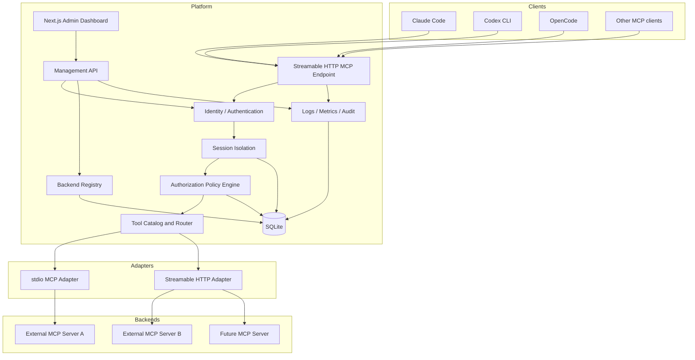

# System Architecture — Universal MCP Gateway

## 1. Principles

- Generic MCP gateway; no backend-specific core.
- Official MCP SDK for protocol implementation.
- Empty production registry by default.
- Dynamic backend configuration.
- Least-privilege authorization.
- Isolated sessions and scoped concurrency.
- Local-only network binding by default.
- Dashboard consumes documented backend APIs; it does not contain business logic.

## 2. Logical architecture



## 3. Deployment topology

Initial local deployment:
- Gateway/API process in WSL2.
- Dashboard served locally by Next.js on a documented separate local port (`3000`), talking to the gateway over loopback at `GATEWAY_ORIGIN` (`http://127.0.0.1:8787`). No reverse proxy, no shared origin, no public listener in Phase 9 — the dashboard reaches the API server-side and the browser only ever talks to the dashboard's own origin.
- SQLite database in project/runtime data directory, excluded from source control.
- Backend child processes launched by the gateway process when stdio adapters are enabled.
- Bind to loopback only.

Do not assume Windows and WSL share identical localhost routing or filesystem paths. Validate cross-environment access before connecting Windows desktop applications.

## 4. Application modules

Suggested source boundaries:

```text
src/
  adapters/
    mcp/
      stdio/
      streamable-http/
    process/
  api/
    routes/
    middleware/
  config/
  core/
    lifecycle/
    gateway/
  registry/
    domain/
    repositories/
    migrations/
  routing/
    catalog/
    dispatcher/
    namespacing/
  security/
    authentication/
    authorization/
    secrets/
    redaction/
  sessions/
  concurrency/
  monitoring/
    logging/
    metrics/
    health/
    audit/
  shared/
    errors/
    schemas/
    types/

apps/
  dashboard/
    app/
    components/
    features/
    lib/
```

This is a target structure, not a requirement to move existing files immediately. Preserve the current working bootstrap and refactor incrementally.

### 4.1 Implemented module layout (Phase 8)

```text
src/
  domain/          # contracts, no infrastructure imports
    primitives.ts        ids, timestamps, secret references
    backend.ts           definition + create/update schemas
    backend-runtime.ts   runtime state, status enum, BACKEND_TRANSITIONS
    agent.ts             profile, enable flag, metadata
    agent-credential.ts  verifier hash, key id, derived status
    policy.ts            rules, effects, deterministic ordering (priority-first)
    session.ts           binding, statuses, termination reasons, deadline helpers
    activity-event.ts    operational history
    audit-event.ts       administrative/security history
    operator.ts          dashboard operator identity + session (Phase 10.0)
    repositories.ts      persistence interfaces (SQL/persistence-free)
  shared/
    errors.ts        AppError, ErrorCode, toAppError, log view
    service.ts       SERVICE_INFO, so routing can name the gateway
  config/
    config.ts        pure parseConfig/loadConfig/redactConfig
  security/
    network-policy.ts    outbound destination policy (SSRF), guardedFetch
  auth/            # Phase 6: nothing here reads the environment except resolveCredentialKeys
    credential-key.ts    token minting, HMAC digest, timing-safe compare, key registry
    auth-service.ts      per-request bearer verification, bounded audit windows
    authorization.ts     policy evaluation, visibleTool filtering, denial audit
    operator-password.ts scrypt hash/verify + dummy verification (Phase 10.0)
  adapters/
    adapter.ts           BackendAdapter interface + createAdapter()
    stdio-adapter.ts     child-process transport
    http-adapter.ts      Streamable HTTP transport
    mcp-client.ts        SDK Client wrapper, error normalization
    lifecycle.ts         BackendLifecycleManager — sole owner of live connections
  sessions/        # Phase 7: the in-process transport registry
    session-manager.ts   sessionful 2025 serving, initialization binding, transport release
  routing/         # Phase 5: discovery → catalog → route
    namespacing.ts       publicToolName, normalization, length bound
    schema.ts            remote JSON Schema → AJV validator (cached)
    catalog.ts           in-memory authoritative catalog, collision policy
    discovery.ts         discovery, coalescing, lifecycle observer
    router.ts            authorize → resolve → backend call (timeout, cancel, activity)
    mcp-server.ts        identity-scoped tools/list + tools/call
  api/
    index.ts             management API assembly + middleware order
    http.ts              correlation (request/correlation ids via ALS), envelopes, JSON parsing, error boundary, HTTP metrics
    middleware/
      guards.ts          loopbackOnly, requireJsonBody
      mcp-auth.ts        bearer authentication boundary for /mcp
      operator-auth.ts   operator session + CSRF boundary for /api/v1 (Phase 10.0)
    schemas/
      queries.ts         pagination/filter/param contracts
    routes/
      system.routes.ts
      backends.routes.ts
      agents.routes.ts   agents, enable/disable, access preview, credentials
      policies.routes.ts policies, assignments
      sessions.routes.ts list, get, terminate, cleanup (Phase 7)
      tools.routes.ts    catalog, discovery reports, conflicts, refresh
      events.routes.ts   activity + audit, list + detail (Phase 8)
      ops.routes.ts      overview, monitoring, diagnostics, settings, openapi + readyHandler
      auth.routes.ts     operator login, logout, session probe (Phase 10.0)
    ops.ts             one snapshot reader: every ops count flows from here
    openapi.ts         OpenAPI 3.1 document, checked against the live route table
  registry/
    backend-service.ts   business rules, transactions, audit, sanitization
    agent-service.ts     agent lifecycle, tombstone + cascade in one transaction
    credential-service.ts issue/rotate/revoke, once-only token return
    policy-service.ts    policy CRUD, target validation, assignments
    session-service.ts   binding, validation, expiry, invalidation, cleanup, audit
    operator-service.ts  password login, lockout, sessions, rotation, CSRF (Phase 10.0)
  core/
    gateway.ts       Hono app + MCP handler + health + API mount + lifecycle + auth
  infrastructure/
    database/
      connection.ts        pragmas, one handle per process
      migration-runner.ts transactional, checksummed migrations
      migrations/0001_initial_schema.sql
      migrations/0002_backend_version.sql
      migrations/0003_runtime_disconnecting.sql
      migrations/0004_agent_authentication.sql
      migrations/0005_session_isolation.sql
      migrations/0006_operator_authentication.sql
      migrations/0007_activity_correlation.sql
      repositories/        SQLite implementations
  monitoring/
    logger.ts        Pino + redaction paths
    context.ts       AsyncLocalStorage correlation: ids in, log fields out (Phase 11)
    metrics.ts       the in-memory aggregate registry + exports (Phase 11)
  cli/
    operator-create.ts    `pnpm operator:create` bootstrap entry
    operator-bootstrap.ts prompt, validation, refusal when already configured
  index.ts           process lifecycle, including the credential-key startup policy
```

Dependency direction is one-way: `index` → `core` → `api` → `registry` → `infrastructure`/`config` → `shared`/`domain`. `sessions/` sits beside `api/` at the edge: it depends on `registry/session-service` and the SDK, and nothing in `registry` imports it (the service notifies it through an injected callback, so the arrow never points back). `domain` imports only Zod and its own primitives, so it can move into a workspace package without changes (ADR-022). `registry` is the only layer that combines several repositories in one transaction. `auth/*` depends on `domain`, `infrastructure` (repository interfaces via `Database`), and `monitoring` — never on `api`, so the middleware is a thin adapter over a testable service.

Boundaries that matter:

- **Domain vs persistence.** Repository interfaces live in `src/domain/repositories.ts` and speak in entities; SQL and `better-sqlite3` types never appear there. An in-memory fake satisfies the same contract.
- **Route vs service vs repository.** A route parses HTTP and formats the response; `BackendService` owns uniqueness, transactions, audit, and sanitization; repositories own SQL. No handler contains a statement or a business rule.
- **Definition vs runtime.** `backends` holds configuration; `backend_runtime` holds observed connection state. A persisted backend never implies a live connection. Live objects (child processes, HTTP clients) live only in the lifecycle manager, never in either table.
- **Service vs lifecycle.** `BackendService` is synchronous and owns no connections. After a mutating transaction commits, the route calls `lifecycle.reconcile(id)` once: the manager re-reads the committed row, compares a connection fingerprint, and decides what the change means for live state (ADR-034). The service never spawns or dials.
- **Who owns the manager.** One `BackendLifecycleManager` per process, constructed in `createGateway()` and passed to the management API, so `connect` routes, `runtime` reads, startup `recover()`, and `shutdown()` all see the same connections. It is injectable for tests.
- **Activity vs audit.** Separate entities, tables, and interfaces. Operational volume must not dilute administrative history, and audit is append-only.
- **Contracts vs secrets.** Agent tokens are not part of the `Agent` entity; only a verifier hash is stored. Backend `env`/`headers` accept secret *references* only.
- **Service vs middleware vs in-request check.** `AuthService` verifies a header and returns either an identity or a reason — it knows nothing about Hono. `mcpAuthenticate` is the only place the header is read. `AuthorizationService` decides about a *known* agent and knows nothing about HTTP. `ToolRouter` re-checks before resolving, so a caller that bypasses the SDK still cannot call a tool it was not granted.

### 4.2 Management API middleware order (Phase 3, extended in Phase 10.0)

Declared once in `createManagementApi()`, applied to every `/api/v1` route:

1. `requestId` — assigns or accepts a well-formed `X-Request-Id` so later log lines and error envelopes correlate.
2. `loopbackOnly` — rejects a non-loopback socket, a non-loopback configured `HOST`, a foreign `Host`, and a foreign `Origin`.
3. `operatorAuth` — requires a live operator session, default-deny, with a closed exemption list (`POST /auth/login`, `POST /auth/logout`). Also verifies `X-CSRF-Token` on every non-safe method.
4. `jsonBodyLimit` — bounds the body before any parse allocates it.
5. `requireJsonBody` — rejects a declared non-JSON content type, which blocks cross-site form posts.

Order is load-bearing. The local-only check runs before a body is read, so a non-local caller cannot make the gateway buffer a payload. `operatorAuth` sits *before* the body limit and the content-type check for the same reason: an anonymous caller cannot spend parse budget, and `tests/operator-auth.test.ts` asserts a write with a malformed body answers `401`, not `400`. Session first, CSRF second — a valid-looking CSRF token with no session still gets `401`, so a token alone never authorizes.

Host/Origin checks reuse the SDK's own `validateHostHeader`/`validateOriginHeader`; only the response envelope differs from `/mcp` (ADR-029).

The MCP surface keeps the SDK's `hostHeaderValidation`/`originValidation` middleware because a JSON-RPC client expects a JSON-RPC error. Both middlewares are scoped away from `/api/v1` so neither surface answers in the other's shape, and `operatorAuth` is scoped away from `/mcp` so an operator cookie is never read as an agent identity.

The API is not mounted at all when no store is configured, *and not mounted when no `OperatorService` exists either* — there is no unauthenticated management mode to fall back to.

## 4.3 Outbound connection lifecycle (Phase 4)

`src/adapters/lifecycle.ts` is the only place a backend is spawned or dialled. `docs/BACKEND_SPEC.md` §6.1 is the method-by-method contract; the architecture points are:

- **Serialized per backend.** Each backend gets one promise chain, so two concurrent `connect` calls open one connection, not two.
- **Explicit only.** Create, update, `enable`, and process start never connect. `enable` makes a backend eligible; `disable` cancels a pending retry and tears the connection down.
- **Recovery is safe, not eager.** On start, any persisted `connected`/`connecting`/`unhealthy`/`disconnecting` is a claim by a dead process. `recover()` rewrites it to `disconnected` (or `disabled`) and does not dial. A persisted `error` is preserved.
- **State machine enforced at the write.** `BACKEND_TRANSITIONS` declares every legal edge and `persist()` refuses anything else, so an impossible status cannot reach the table.
- **Backoff is bounded and jittered.** `initialDelay * 2^(n-1)`, capped, ± `jitterRatio`, at most `maxAttempts`. Only `BACKEND_TIMEOUT` and `BACKEND_UNAVAILABLE` retry; a bad executable, a policy refusal, or a rejected credential is permanent. Off by default (`RECONNECT_ENABLED=false`).
- **Shutdown order.** `Gateway.close()` closes the MCP handler, then awaits `lifecycle.shutdown()`, then the caller closes the store — so a teardown can still write a truthful runtime row.
- **Destination policy before the socket.** `src/security/network-policy.ts` validates scheme, credentials, and every DNS-resolved address, and wraps `fetch` so the check runs per request (SSRF; `docs/SECURITY.md` §3.2).

`docs/BACKEND_SPEC.md` §6 describes the transports; `tests/lifecycle.test.ts` and `tests/lifecycle-api.test.ts` exercise them against isolated fixtures only.

## 4.4 Tool discovery and routing (Phase 5)

`src/routing/` is one pipeline with four separable pieces; each file has one job and can be read alone.

- **`namespacing.ts` — identity.** `publicToolName(backendId, originalName)` joins two normalized segments with `__`. Normalization replaces every character outside `[A-Za-z0-9._-]` with `_`; a name longer than 128 characters is cut and suffixed with `__<8 hex>` derived from `SHA-256(backendId, NUL, originalName)`. Same inputs, same name, always (ADR-036).
- **`catalog.ts` — truth.** The catalog is in memory and authoritative. It holds one snapshot per backend (tools keyed by original name) plus an index from public name to owner. Collisions are computed at read time from the whole index, and **every** claimant is withheld rather than routing by discovery order. Nothing is persisted: a catalog row on disk would be a claim about a connection that a restart cannot honour (ADR-038).
- **`discovery.ts` — acquisition.** Calls `tools/list`, validates metadata, builds the snapshot, and swaps it atomically. Concurrent discoveries for one backend coalesce onto one request. A listing that fails leaves the previous snapshot untouched but does not resurrect it after a disconnect — the lifecycle observer removes the backend entirely, so a stale map cannot outlive its connection.
- **`router.ts` — dispatch.** Resolves at call time, re-checks runtime truth (`enabled`, `connected`), validates arguments against the backend's own schema, then calls the owning client. The timeout is `min(toolCallTimeoutMs, backend.timeoutMs)` so a backend's configured budget is never widened. Cancellation is classified from `context.signal.aborted`, not from the error's shape.

`mcp-server.ts` projects a catalog tool into the protocol payload. Its only assertion — `Tool[]` — is justified because `toDefinition` has already validated the shape; the alternative is rebuilding every remote schema in Zod, which would lose `$defs`, vendor extensions, and formats (ADR-037).

The catalog is served through a **low-level `Server`**, not `McpServer`: `McpServer.registerTool` binds its request handlers once at construction, which cannot describe a catalog that changes during the process's life. One server instance is created per exchange and holds no state.

**Lifecycle coupling.** The manager exposes `setConnectionObserver()`; discovery registers an observer that fires on connect and disconnect. The setter (rather than a constructor argument) breaks the mutual reference, and the observer is fire-and-forget so an observer bug can never fail a connect or block a teardown. `activeClient(backendId)` returns a client only when the runtime status is exactly `connected`, resolved per call and never cached.

## 4.5 Operational read surface (Phase 8)

Overview, monitoring, readiness, diagnostics, settings, activity and audit are
read-only views over state the gateway already owns. They add no tables, no
cache, and no background sampler; they answer from the same repositories and the
same in-memory catalog everything else uses.

Three structural choices:

- **One snapshot reader.** `src/api/ops.ts` exports `opsSnapshot()` and every
  consumer calls it: `/overview`, `/monitoring*`, `/diagnostics`. Three endpoints
  computing backend counts down three code paths is the classic dashboard bug;
  with one reader the numbers cannot disagree, and a single fix corrects all of
  them.
- **`null` is a different claim from `0`.** A storage read that fails yields
  `database: "unavailable"` and `null` for every storage-backed field. The
  in-memory catalog is still reported, because it survived the outage. A
  dashboard branches on `null`, never on `0`.
- **The count queries are single statements.** Enabled/disabled splits, the
  runtime distribution, session effective-status counts, and activity/audit
  groupings are one `SELECT` each — no per-row or per-type query, so the overview
  cannot become an N+1 by accident.

Readiness is separated from liveness on purpose. `/health` answers while the
process can serve and never inspects a dependency. `/ready` asks whether storage
answers and the migration ledger is readable, and **not** whether optional
backends are connected: a gateway with every backend disconnected is still ready
to accept work. Both are mounted outside `/api/v1`, because an infrastructure
probe should not follow an API version.

Audit immutability is a property of the repository interface: `AuditRepository`
declares no update and no delete method, so no route can acquire a write path by
accident. The list endpoint omits `metadata`; only the detail read renders it —
one explicit operator act, not a collection response carrying free-form context.

`GET /api/v1/openapi.json` is a hand-written literal table
(`src/api/openapi.ts`), because Hono exposes no typed route metadata: a generator
would describe the schemas and guess which one belongs to which handler. Query
parameters are derived from the same Zod schemas the handlers parse, and
`tests/openapi.test.ts` compares the document against the live route table in both
directions, so neither an undocumented route nor an invented one survives.

## 4.6 Observability layer (Phase 11)

Two additions, one rule: **no store the gateway does not already own**. No
Redis, no Prometheus, no OpenTelemetry — the phase adds an ALS correlation
context and an in-memory aggregate registry, and both reset with the process.

- **Correlation runs first on the outer app.** `requestCorrelation` mounts
  before any guard, so even a request refused by loopback rejection is
  correlatable. It generates/echoes `X-Request-Id` and accepts
  `X-Correlation-Id` only when it matches `^[A-Za-z0-9._-]{1,64}$` — validated,
  never trusted. Both ids live in `AsyncLocalStorage`
  (`src/monitoring/context.ts`), not a global: deep call sites read them through
  `correlationLogFields()` without a threaded parameter, and concurrent
  requests stay isolated. `activity_events.correlation_id` persists the join
  (migration `0007`); audit keeps `requestId` only.
- **The registry is one module-level singleton.** Writers import `metrics`
  from `src/monitoring/metrics.ts`; no constructor threading, no DI — the
  aggregate must be observable from any layer, which is exactly the property
  constructor injection exists to prevent. Labels are closed enums (never a
  tool name, agent id, or user input), violations drop into
  `umg_metrics_dropped_total`, and the API never throws into a request path.
- **Two exports, one boundary.** `GET /metrics` (Prometheus text, root,
  operator cookie + loopback, mounted only when an operator exists) and
  `GET /api/v1/monitoring/metrics` (JSON, inside the versioned API) render the
  same in-memory numbers. There is no unauthenticated metrics port.
- **Telemetry is aggregate-only by design.** Activity rows keep the durable
  per-event trail; audit keeps the security trail; the registry keeps counts.
  No store duplicates another's facts, and none carries tool arguments,
  results, credentials, or messages — the error ring keeps `{code, component,
  at, requestId}` and nothing else.
- **Health, readiness and diagnostics remain three answers.** Liveness never
  consults storage; readiness checks storage and migrations; diagnostics adds
  configuration facts, registry state and recent errors, and reports a closed
  store as `unavailable` while the in-memory registry keeps reporting real
  numbers — neither side fabricates the other's answer.

## 4.7 Managed integrations (Phases 12–17)

ADR-048–056. A second tool source type — `managed_integration` — enters through
one seam and borrows everything else: catalog, authorization, metrics, audit.
**Three providers ship registered:** GitHub (ADR-053, fine-grained PAT),
Notion (ADR-055, internal connection token), and Slack (ADR-056, manually
supplied bot token) — all code-registered and read-only; the registry is still
code and still has no runtime widening.

- **`src/integrations/` is the whole module:** `source.ts` (the closed
  `{sourceType, sourceId}` pair), `provider.ts` (registration schema and the
  two capabilities), `connection.ts` (seven statuses, transitions-as-data,
  non-secret metadata), `registry.ts` (the `REGISTRATIONS` module constant —
  `githubRegistration`, `notionRegistration`, and `slackRegistration` are its
  entries — plus a validating `register()`; the constructor default is an
  empty registry, so tests wire exactly what they assert), `connector.ts` (the
  guest contract and `withCancellation`), `runtime.ts` (the dispatch gate),
  `vault.ts` (the AES-256-GCM envelope), `service.ts` (lifecycle,
  credentials, `verify`, `dispatchable`), `github/`, `notion/`, and `slack/`
  (the three connectors, each the same three-file shape: a provider-owned
  HTTP client with fixed origin, closed header set, bounded single retry;
  `tools.ts` with strict inputs and `.strict()`-enforced outputs; a connector
  module composing them). Notion landed with zero changes outside its own
  directory and the registry entry; Slack repeated the proof with a different
  failure model — HTTP 200 answers that are application failures
  (`{ok: false, error}`), both envelope halves read on every response.
- **The seam is one branch in `ToolRouter.call()`, after authorization.**
  MCP-only helpers are narrowed to the MCP variant of the `CatalogTool` union
  so the compiler enforces the seam. No runtime wired → `TOOL_UNAVAILABLE`;
  no MCP fallback exists behind the seam. The runtime re-checks the
  connection row before every dispatch, so a stale catalog entry is refused,
  not routed.
- **Connectors are bounded guests (ADR-049).** The execution context is a
  whitelist — `{connectionId, metadata, resolveCredential, signal, timeoutMs}`
  — with no store handle, no services, no eager credential value, and no agent
  or operator identity. Timeouts and cancellation are enforced by the gateway,
  not requested of the connector; connector errors normalize onto the existing
  public codes with the connector's message confined to `details`.
- **The identity domains never merge (ADR-048).** Provider = code
  registration; connection = operator row; backend = MCP peer. Connection ids
  are UUIDs; a `backend`-scoped policy rule naming a connection id is rejected
  at creation. Catalog snapshots key on `"<sourceType>:<sourceId>"`, and
  activity rows name one source, structurally: the schema refuses a row with
  both `backendId` and `connectionId`.
- **Fail-closed is the resting state (ADR-050/051).** A connection in any
  non-`connected` status is undispatchable; `reauthorization_required` is
  terminal until an operator acts; a missing `INTEGRATION_MASTER_KEY` never
  blocks startup but no credential can be stored without it. With no
  connection created, the surface still answers empty — the difference in
  Phase 13 is that the operator API and the dashboard can now create one,
  store a token, prove it (`test`, data either way), and publish its tools
  (`enable`, the only path to `connected`).
- **Phase 15 hardened the lifecycle without widening anything (ADR-054).**
  `connected → connecting` made `enable` the in-place refresh of a live
  connection; a connect continuation re-reads the row after discovery, so a
  racing delete/disconnect/disable wins and nothing is published for a row
  that moved; a failed refresh withdraws the stale tool set (an
  `error`/`reauthorization_required` row never lists tools); the GitHub
  client refuses redirects outright; `umg_tool_calls_total` gained a closed
  two-value `source_type` label; and failed connect/refresh attempts write an
  audit row with `result: 'failure'`. The full platform description —
  contracts, pipeline, lifecycle, the checklist for whoever adds the next
  provider — is `docs/INTEGRATION_PLATFORM.md`.

## 5. Inbound MCP lifecycle

1. Client connects to `/mcp`.
2. Transport validates HTTP request and host/origin according to SDK guidance.
3. **Authentication (Phase 6).** `mcpAuthenticate` verifies the bearer credential on this request, writes `auth.succeeded`/`auth.failed`, and either establishes an identity or answers one uniform 401. Nothing else runs on a failure.
4. **Era routing (Phase 7).** `isLegacyRequest` — the SDK's own classifier — decides which protocol era is being served. A 2025-era `initialize`, or any request presenting `mcp-session-id`, goes to `McpSessionManager`; everything else stays on the SDK's stateless leg. Routing both legs through one classifier is what stops the two from disagreeing about a request.
5. **Session (Phase 7).** On `initialize`, the sessionful transport issues a 256-bit protocol id and the gateway writes a `sessions` row (`agent_id`, `credential_id`, `status`, lifetimes) *before* the response is returned. On every later request carrying that id, the database is consulted first: exists → `active` (including both lifetimes) → owned by this agent → same credential → credential unrevoked/unexpired → agent enabled. Only then does the transport see the request. A failure answers one uniform `404 Session not found`.
6. The identity from step 3 builds the server instance for this exchange. A session id never substitutes for it, and the 2026 era has no session id at all — it is per-request by protocol design.
7. `tools/list` reads the in-memory catalog **through `AuthorizationService.visibleTools(agent)`**: only connected, enabled backends, colliding names withheld, and only tools this agent may call. Full list, no pagination (protocol-legal; the catalog is bounded at 2000 tools per backend).
8. `tools/call` authorizes **before** resolving — a denial answers `-32602 "Unknown tool"` and writes `access.denied`. On an allow it resolves the public name, re-checks runtime truth, validates arguments against the backend's own JSON Schema, and applies the call timeout.
9. `ToolRouter` dispatches to the owning backend through the lifecycle's `activeClient`. A cancelled request is classified from the transport's abort signal.
10. Adapter returns MCP-compatible result/error. A backend tool-level failure is a `CallToolResult` with `isError`, never a protocol error; routing failures map onto JSON-RPC codes (`-32602` unknown/invalid, `-32800` cancelled, `-32603` otherwise).
11. Observability records safe metadata and correlation ID: `tools.list`/`tools.call` activity with backend, public name, outcome, error code, duration — no arguments or results.
12. Session/transport resources are released through the SDK's own lifecycle: `onsessionclosed` (client `DELETE`) terminates the session as `client_deleted`, and every path that ends a session — API terminate, revocation, cleanup, shutdown — also closes the registered transport. A transient (non-initializing) exchange closes its server immediately.

## 6. Outbound adapter lifecycle

Implemented in Phase 4 (`src/adapters/`, `docs/BACKEND_SPEC.md` §5–6). The adapter interface is deliberately narrow: connect to the official MCP Client SDK client, close, and expose a loggable target. Lifecycle, retry, health, and state persistence belong to the manager, so adding a transport does not mean reimplementing them.

`McpBackendClient` wraps the SDK `Client` to normalize SDK/transport/OS failures onto the gateway's `AppError` taxonomy and own the per-call timeout. It walks the error's cause chain, so a wrapped `ECONNREFUSED` is still recognized as transient and a wrapped policy refusal still surfaces its real message.

A backend failure never crashes the gateway: `connect` rejects with a mapped error, the runtime row records a sanitized code, and the process stays up. See §4.3 for ownership and recovery.

## 7. Registry model

Implemented in Phase 3 (`src/domain/backend.ts`, `src/registry/backend-service.ts`, `docs/BACKEND_SPEC.md`).

Backend definition fields:
- `id` — application-generated UUIDv4.
- `name` — unique among active backends (`RESOURCE_CONFLICT` on clash).
- `description` — optional, nullable.
- `connection` — discriminated union on `type`: `stdio` or `streamable-http`.
- `enabled` — configuration flag only; not a connection.
- `timeoutMs` — per-call timeout applied later by an adapter.
- `concurrencyMode` / `concurrencyLimit` — `parallel` | `serialized` | `limited`.
- `version` — optimistic-concurrency counter, incremented on every persisted change.
- `createdAt`, `updatedAt`.

Runtime state is a separate row and never part of a definition:
- `status` — `disconnected` | `connecting` | `connected` | `unhealthy` | `disconnecting` | `error` | `disabled`.
- `lastConnectedAt`, `lastHealthCheckAt`, `lastErrorCode`, `lastErrorAt`, `reconnectAttempts`.

Rules enforced by the registry service:

- Creating, updating, enabling, or disabling **cannot** connect, spawn, or resolve anything. Only two configuration-visible runtime transitions exist: disable → `disabled`, enable from `disabled` → `disconnected`. A `connected` state is never fabricated.
- A definition's `env`/`headers` may hold secret *references* (`secret:...`, `env:VAR`) only. A literal secret is rejected by the schema, so an API response cannot leak one by construction.
- A stdio `command` is a single executable token. Arguments, flags, and pipes belong in `args`; a shell-looking command is rejected rather than split.
- Deletion is a tombstone: the backend leaves the registry, runtime state cascades, and audit rows keep referencing the id.

Do not store plaintext secrets in ordinary registry JSON/YAML or database columns. Use secret references and a separately designed secure store.

## 8. Tool catalog and naming

Implemented in Phase 5 (`src/routing/`, ADR-036/037/038). Public name:
`<normalized_backend_id>__<normalized_original_tool_name>`.

Normalization is total and deterministic: every character outside
`[A-Za-z0-9._-]` becomes `_`, so `search items` and `search_items` produce the
same public name and therefore genuinely collide. Names over 128 characters are
cut and suffixed with `__<8 hex of SHA-256(backendId NUL originalName)>` — the
suffix is derived from identity, never random, so the same tool keeps the same
name across restarts and rediscoveries.

Catalog record (`src/domain/tool.ts`):

- public name, original name, backend ID
- description, input schema (the backend's own JSON Schema, forwarded verbatim)
- availability: `available` | `unavailable` | `conflict` | `rejected`
- discovery/update timestamps

**Collision must be explicit and fail closed.** Every claimant of a colliding
public name is withheld; no first-writer-wins, no last-wins. Within one backend,
two originals that normalize to one name keep the first and mark the rest
`rejected` with the reason, so the report says what happened. Conflicts are
recomputed from the whole index on every read, so a backend disconnecting
releases the names it was blocking.

Nothing is persisted: the catalog is derived state, rebuilt by rediscovery. A
stored catalog would outlive the connection it described, which is the exact
staleness the spec forbids.

**Phase 12 addendum (ADR-048).** The catalog record's `backend ID` field became
a source pair: `sourceType` (`mcp_backend` | `managed_integration`) plus
`sourceId`. For MCP the `sourceId` **is** the backend id and the record keeps
its `backendId` field with the same value, so every pre-Phase-12 reader is
unchanged; for a managed tool the `sourceId` is a connection id and no
`backendId` is fabricated. The same deterministic naming path produces
`<sourceId>__<tool>` for both, snapshots key on `"<sourceType>:<sourceId>"`,
and conflicts behave identically across source types — two claimants of one
public name withhold both, whoever they are. Discovery reports remain
MCP-only: a managed source has no handshake to describe.

## 9. Authentication and authorization

Separate:
- Dashboard operator identity (Phase 10.0, implemented — §9.2).
- MCP client/agent identity (Phase 6, implemented — §9.1).
- Backend credentials.

Use separate credential scopes. Dashboard login must not implicitly grant MCP tool access. MCP client metadata must not be trusted as identity. The two boundaries share no table, no middleware, and no token format on purpose: an operator cookie at `/mcp` gets `401`, and an agent bearer at `/api/v1` gets `401`.

Policy evaluation:
1. Authenticate caller.
2. Resolve active agent profile.
3. Load effective policy.
4. Filter tools/list.
5. Re-check permission on every tools/call.
6. Audit allow/deny outcome without recording secrets or sensitive payloads.

Default deny for unknown identities and unassigned tools.

### 9.1 Implemented in Phase 6

```
Authorization: Bearer umg_live_<base64url>
        │
        ▼  src/api/middleware/mcp-auth.ts   (mounted on /mcp only)
   AuthService.authenticate
     shape → HMAC-SHA-256 → indexed lookup by digest → timing-safe re-compare
     → key id known? → not revoked/expired? → agent exists and enabled?
        │                                     │
     identity                          401 (one shape, one message)
        │
        ▼  createMcpHandler factory  (once per request, never reused)
     agent re-read from the store, so a disable between verify and handle is honoured
        │
        ├── tools/list → AuthorizationService.visibleTools(agent)
        └── tools/call → ToolRouter.call(..., { agent, credentialId })
                            └── authorize() BEFORE resolve()
                                  ├─ allowed  → resolve → backend → result
                                  └─ denied   → -32602 "Unknown tool" + access.denied audit
```

Three invariants hold this together:

1. **One identity per exchange.** The SDK server factory receives the authenticated identity and builds a fresh instance around it. There is no object shared between agents, so a server instance cannot serve two identities.
2. **One decision function for both directions.** `tools/list` filtering and `tools/call` rejection call the same `AuthorizationService.evaluate`. Drift would require changing one call site and not the other, and both are three lines long.
3. **Deny before route.** A denied caller learns nothing: no backend is read, no reachability check runs, no schema is compiled, nothing is invoked, and the error is byte-identical to an unknown tool. `AuthorizationService.resolveTarget` is the single catalog read behind the decision (a `backend`-scoped rule needs to know the tool's backend) and is also what enriches the audit row; it never gates a call on its own.

`AuthService` and `AuthorizationService` are composed in `src/core/gateway.ts` and injected; neither reads the environment. The hashing key is loaded by `src/index.ts` through `resolveCredentialKeys`, which throws in production when absent and returns keys that issue nothing otherwise, so a development process without a secret fails closed per request instead of inventing an ephemeral one.

### 9.2 Implemented in Phase 10.0 (management surface)

```
POST /api/v1/auth/login  (exempt)          every other /api/v1 route
        │                                          │
        ▼  src/registry/operator-service.ts        ▼  operatorAuth
   findByUsername (case-insensitive)          read `umg_operator` cookie → shape check
     → dummy scrypt if unknown  ─────────┐      → HMAC(token) → indexed lookup by digest
     → verify scrypt hash                │      → key id current? → not revoked?
     → locked_until in the future?       │      → not past idle or absolute ceiling?
     → operator enabled?                 │      → operator still enabled?
        │                                │              │
   mint 256-bit token, store digest      │         identity
   rotate: end any session on this       │              │
   cookie first (fixation defence)       │              ▼  non-safe method?
        │                                │         X-CSRF-Token == HMAC(token, "operator-csrf-v1")?
        ▼                                │              │
   Set-Cookie + csrfToken          uniform 401 on failure  proceed
```

**The boundary is in the gateway, not in Next.js.** The REST surface is reachable on `127.0.0.1:8787` by any local process, and `curl` does not load a page, so a guard in the dashboard would be cosmetic. `createGateway` refuses to mount `/api/v1` without an `OperatorService`, which removes the "unauthenticated mode" that a missing dependency would otherwise create.

**Two lifetimes, both derived on read.** A session has an idle window (30 min) and an absolute ceiling (12 h). Neither is trusted from a background sweep — a missed cleanup must not extend access — and a rejected session has its row marked ended and its cookie cleared so a dead cookie cannot loop.

**Rotation at login.** A login that arrives carrying a session ends that session before minting the new one, so an id chosen before login cannot survive it.

**Storage is digest-only.** Only an HMAC-SHA-256 digest of the cookie value is stored, keyed by `CREDENTIAL_HASH_SECRET` with its own key id; a session whose `hash_key_id` is no longer the issuing key is refused rather than accepted unverifiable.

**The dashboard asks, it does not decide.** `getOperatorSession()` probes `GET /api/v1/auth/session`, cached per render pass. A revoked cookie and an absent cookie are indistinguishable there — which is what a cookie-existence guard would get wrong — and the dashboard's login route forwards credentials to the gateway rather than verifying them. Full detail in `docs/SECURITY.md` §4.3 and §8.1.

## 10. Session isolation (Phase 7)

Two identifiers, and the distinction is the whole design:

| | `sessions.id` | `mcp_session_id` |
| --- | --- | --- |
| Owner | gateway | SDK transport, echoed by the client |
| Purpose | management API and audit target | routing handle |
| Authenticates | nothing | nothing |
| Exposed to | operator only | client and operator |

**Guarantee: one protocol session ↔ one agent ↔ one credential.** Enforced in three places, in
order of strength: a partial `UNIQUE` index on `mcp_session_id` (two bindings are unrepresentable),
a `BEFORE UPDATE` trigger making `agent_id`/`credential_id`/`mcp_session_id`/`id`/`created_at`
immutable, and a `BEFORE UPDATE` trigger refusing reactivation. Application code cannot weaken
that, and neither can a second gateway process.

**Two eras, because the installed SDK has two.** Verified against server/client `2.4.0`, not
assumed:

- The **2026 era** (`2026-07-28`) is per-request. `createMcpHandler` issues no `mcp-session-id`;
  each exchange is a fresh server with a freshly verified identity. There is nothing to bind, and
  a client-supplied session id is validated against the database if present and refused otherwise.
- The **2025 era** has a real protocol session. Serving it requires
  `WebStandardStreamableHTTPServerTransport` with `sessionIdGenerator` +
  `onsessioninitialized`/`onsessionclosed`, which is exactly what `src/sessions/session-manager.ts`
  wires. The default `createMcpHandler` (`legacy: 'stateless'`) would never issue an id, so a
  binding layer on top of it would have been dead code.

**Why only two request shapes take the sessionful leg.** `isLegacyRequest` is the SDK's own
classifier, and within the legacy era only an `initialize` (where a session is created) or a
request already carrying `mcp-session-id` goes to the manager. Everything else stays on the
stateless leg. This is not a shortcut: it is what keeps Phase 1–6 behaviour intact — a one-shot
`tools/list` with no session id still returns `200` with no session, exactly as before — while a
client that keeps the id it was given gets full enforcement from the second request onward. The
earlier alternative (routing *all* legacy traffic through the sessionful transport) was rejected
because it turned every sessionless one-shot call into `400 Server not initialized`.

**Registry vs database.** `McpSessionManager` keeps a `Map<protocolId, {server, transport,
internalId}>`. It is a routing table, not a security boundary: a missing entry is refused, and a
present entry is still re-validated against the database on every request. It is process-local, so
a session created by one process cannot be served by another — stated as a limitation rather than
hidden. What survives a process boundary is the row and its constraints.

**Ending a session.** Every path funnels into `SessionService`, which ends the row in a single
conditional `UPDATE ... WHERE status = 'active'` (so one termination wins and repeats are no-ops),
audits only an actual transition, then releases the transport through an injected `onEnded`
callback. That callback exists so the dependency stays one-way: `registry/session-service` never
imports `sessions/session-manager`.

| Trigger | Status | Reason |
| --- | --- | --- |
| operator / API | `terminated` | `operator_terminated` (or an explicit closed-enum reason) |
| client `DELETE` | `terminated` | `client_deleted` |
| credential revoked | `invalidated` | `credential_revoked` |
| credential rotated | `invalidated` | `credential_rotated` |
| agent disabled | `invalidated` | `agent_disabled` |
| agent deleted | `invalidated` | `agent_deleted` |
| idle | `expired` | `idle_timeout` |
| hard cap | `expired` | `max_lifetime` |
| shutdown | `terminated` | `gateway_shutdown` |

**Expiry is per request, not per sweep.** Two lifetimes: the idle deadline
(`lastActivityAt + SESSION_IDLE_TIMEOUT_MS`, default 30 min) and the hard cap (`createdAt +
SESSION_MAX_LIFETIME_MS`, default 12 h). Both are checked on the request path, so a missed sweep
cannot extend access. `POST /api/v1/sessions/cleanup` only writes back what a request would already
refuse, keeps every row, and touches only `status = 'active'` — so a concurrent terminate is never
overwritten.

**Graceful shutdown.** `Gateway.close()` terminates every active session (`gateway_shutdown`) first,
then closes transports, then lets the caller close the store. Leaving `active` rows behind would
make the next process believe sessions are live that nothing can serve.

## 11. Concurrency

### 11.1 Session state (Phase 7)

The guarantee needed is narrow and worth stating precisely: **two requests can never observe or
produce an inconsistent session**, and no path can leave a session half-ended.

- **One connection, synchronous driver.** `better-sqlite3` is synchronous and this process holds a
  single handle, so every statement runs to completion before the next begins. There is no
  in-process interleaving inside a statement, and therefore no need for an in-memory mutex — and
  no mutex whose lock could be leaked on a timeout or cancellation.
- **Decision and write are one statement.** `touch`, `end`, `endWhere`, and `expire` each carry
  their precondition in the `WHERE` (`status = 'active'`, `last_activity_at <= ?`). A read-then-write
  sequence would have a window; this design has none. `endWhere` returns the changed rows via
  `RETURNING`, so the caller releases exactly the transports it ended.
- **Invariants are in the database, not in memory.** The unique protocol id, the immutability
  trigger, the no-reactivation trigger, and the terminal-completeness trigger hold across
  processes. A second gateway pointed at the same file cannot violate them.
- **Duplicate initialization.** Two transports cannot both bind one protocol id: the second
  `INSERT` hits the unique index and the initialization fails. Asserted by
  `tests/sessions.test.ts` (service level) and by the unique index in `verify-0005.ts`.
- **Terminate vs. request.** The request path validates *before* the transport handles anything,
  and the terminate path is a single conditional update. A request that validated first may
  finish; one that arrives after the update sees `terminated`. Neither leaves a row that claims
  to be usable.
- **Concurrent cleanup.** Each sweep statement is conditional on `status = 'active'`, so N
  concurrent sweeps perform exactly one transition; the rest change zero rows. Rows are never
  deleted, so a sweep cannot race a reader into a missing row.
- **No unbounded waiting.** There are no locks to acquire and no cross-process wait, so there is
  nothing to time out, cancel, or leak.

**Multi-process limits, explicitly:** the transport registry is per process, session serving is
therefore single-process, and `better-sqlite3` serializes writers with SQLite's own write lock
(`SQLITE_BUSY` on a long-held write from another process is surfaced as `DATABASE_ERROR`, not
retried). Running more than one gateway process against one database is not a supported topology
in this phase.

### 11.2 Backend calls

Per-backend/resource modes (`parallel` | `serialized` | `limited`) are modelled in
`backends.concurrency_*` and validated by the schema. The lifecycle manager serializes
*connection state* per backend with one promise chain (§4.3), so two concurrent connects open one
connection. Tool-call concurrency across backends is not queue-gated in this phase: each call
resolves the owning client and awaits it, and cancellation comes from the transport's abort
signal. A per-backend queue with a bounded `limited` mode is **still deferred**: Phase 8
standardized the API surface instead, and the columns exist so no migration will be needed when
it lands. Until then `concurrencyMode` is stored and validated but not enforced at call time.

## 12. Data persistence

SQLite stores registry metadata, agent profiles, policy records, audit events, and any bounded operational metadata. Access goes through the repository interfaces in `src/domain/repositories.ts`; SQL is confined to `src/infrastructure/database/`. Runtime MCP client/transport/process objects stay in memory.

Implemented in Phase 2 (details in `docs/DATABASE.md`):

- One connection per process, WAL + `synchronous=FULL` + `foreign_keys=ON`.
- Transactional, checksummed, additive migrations; applied files are immutable.
- Soft delete (tombstone) for backends and agents; hard delete with cascade for policies; revocation timestamps for credentials.
- Credential status is derived from timestamps, not stored. Session status **is** stored as of Phase 7 (a terminal state cannot be expressed by a clock, and an operator's decision must survive one), while a lapsed lifetime is still derived and enforced per request.

Retention and backup policy are still to be defined. Do not store sensitive tool arguments/results by default.

## 13. Dashboard architecture

### 13.1 Shape

The dashboard is a Next.js App Router application in `apps/dashboard`, a pnpm
workspace package (`@universal-mcp-gateway/dashboard`). The gateway stays the
**root** package — it was not moved into `apps/gateway`, so there is no
`apps/gateway/package.json`, and `dev:gateway` / `build:gateway` simply alias the
root scripts.

```text
apps/dashboard/
  src/app/(dashboard)/       route group — shell, nav, pages
  src/app/api/proxy/         same-origin allowlisted GET proxy
  src/components/            layout / feedback / ui compositions
  src/lib/api/               typed client, envelope unwrap, ApiError
  src/lib/navigation.ts      single source for nav + titles + placeholder copy
  tests/                     jsdom component tests + validator tests
```

### 13.2 Trust boundary

The gateway binds `127.0.0.1` and grants **no CORS**, so a browser cannot call it.
Two paths exist, and only two:

| Path | Where it runs | Used for |
| --- | --- | --- |
| `lib/api/client.ts` → `GATEWAY_ORIGIN` | server only (RSC, route handlers) | all initial reads |
| `/api/proxy/[...path]` → same allowlist | browser → same origin → server | client-triggered refresh |

`GATEWAY_ORIGIN` is deliberately **not** `NEXT_PUBLIC_*`: the browser never learns
the gateway address, and the proxy is an allowlist of documented GET reads
(including `/ready`), not a general passthrough. Every `/api/v1` read carries the
operator cookie (server components) or the proxy forwards the single operator
cookie (client refresh) — it forwards only `umg_operator`, never the whole jar.
`/ready` stays unauthenticated, so the header indicator works even after the
session expires.

The management API is operator-authenticated (Phase 10.0, §9.2), so **local
access plus an operator session** is the trust boundary. The dashboard must not
be exposed beyond loopback: the session cookie crosses plain HTTP there, which is
only acceptable because loopback never leaves the host.

The proxy forwards `upstream.status` verbatim, which is why two different
conditions both surface as `503`:

- gateway unreachable → `503` + the standard error envelope
- gateway reachable but not ready → `503` + a valid readiness document

Consumers must therefore decide on **payload shape**, not on `response.ok`. See
§13.4.

### 13.3 API client

- Every response is unwrapped from the `{ data }` envelope; anything else is an
  `invalid-response` error.
- Failures become `ApiError` with a closed `kind` (`unavailable`, `timeout`,
  `http`, `invalid-response`, …), an operator-readable `userMessage`, and an
  optional `requestId`. A raw thrown value never reaches the UI, so a SQL string
  or request URL cannot leak into a page.
- `null` vs `0` is preserved end to end: `null` means the read failed and renders
  as "Unavailable"; `0` means none and renders as `0`.
- Types in `lib/api/types.ts` are hand-written from `docs/API_REFERENCE.md`, not
  generated, because `z.toJSONSchema()` describes shapes but not the
  `null`-vs-`0` semantics that matter most here.

### 13.4 Readiness presentation

`components/feedback/gateway-status.tsx` is a client component that takes the
server-rendered readiness value as `initial` and refreshes on demand — there is
no polling, so an idle dashboard is not a request generator.

`lib/validation/readiness.ts` validates the body against the real contract in
`src/api/routes/ops.routes.ts` (`readyHandler`): `status`, both `checks` members,
`timestamp` required; `migrationVersion` optional, because the handler
spread-omits it exactly when migrations are unreadable. A correct
`!response.ok` guard would be wrong here: it would turn a legitimate
`not_ready` answer into "unreachable" and make that state dead code.

### 13.5 Design system

- Astryx is the direct component library and design system; it is consumed as
  packages, never copied source.
- Theme wiring is CLI-generated (`src/astryx-themes.js`) and must not be
  hand-edited; `src/astryx-themes.d.ts` types it because `allowJs` is off.
- Cascade-layer order is declared once in `src/app/globals.css` and must stay the
  first import in `layout.tsx`:
  `@layer reset, theme, base, astryx-base, astryx-theme, components, utilities;`
- No local `color-scheme` rule: `@astryxdesign/core/reset.css` maps `data-theme`
  to `color-scheme`, and unlayered CSS here would win and pin the page to light.

**Explicit exclusion:** no shadcn/ui, no Radix UI fallback component library, and no parallel design system. Follow the current Astryx official installation/API documentation. Do not guess package names or CLI commands.

### 13.6 Remaining rules

- Feature-oriented page modules.
- Server-side authorization for protected dashboard routes and APIs — **the
  gateway enforces it** for every `/api/v1` route (Phase 10.0, §9.2). The
  dashboard's `(dashboard)` layout asks the gateway whether the session is live
  and redirects to `/login?next=…` when it is not; it is not itself the guard, so
  a dashboard bug cannot open the API.
- Loading, empty, error, and confirmation states.
- No business rules implemented only in the browser.
- `/dashboard` is the only functional page today; every other module route is a
  placeholder that says so. See `docs/DASHBOARD.md` Part II.

## 14. Security boundaries

- Loopback binding by default; a non-loopback `HOST` is refused at config load.
- The MCP surface requires a per-agent bearer credential (Phase 6). The management API requires an operator session (Phase 10.0), on top of the local-only boundary (socket address, `HOST`, `Host`, `Origin`) and a JSON content-type requirement. Before Phase 10.0 the management API had no identity: a local caller could spawn a process (Phase 4) and mint a credential (Phase 6). That blast radius is now behind a password login, which narrows *who* can reach it but does not make remote exposure safe — there is no TLS, no RBAC beyond a single owner, and no per-IP rate limit. Phase 8 added `/settings` and `/diagnostics`; both report effective configuration and deliberately never a secret, an environment value, a token, or a private path. Phase 9 added a local dashboard; it must not be exposed via tunnel, proxy, or non-loopback bind.
- MCP authorization is default-deny, evaluated per request, with `tools/list` filtered and `tools/call` re-checked before resolution. A denial is byte-identical to an unknown tool.
- Outbound Streamable HTTP destinations pass a documented policy: `http`/`https` only, no embedded credentials, DNS-resolved address classification, per-request re-check, same-origin redirects. `ALLOW_PRIVATE_NETWORK` opens loopback/private/CGNAT for local fixtures and never metadata or link-local.
- Registration, enable, and process start never connect; a connection requires an explicit `connect`, and a restart rewrites persisted live state to `disconnected` without reconnecting.
- Origin/Host validation on both surfaces, each answering in its own protocol's error shape.
- Redacted logs; secrets exist only as references, so there is nothing to redact in a payload.
- Safe stdio process launch with executable and argument arrays; no shell interpolation.
- Controlled environment inheritance (SDK default set plus explicitly referenced variables).
- No public exposure before security review.

## 15. Error taxonomy

Implemented in `src/shared/errors.ts` as `AppError` with stable `ErrorCode` values. Each code has a fixed category, HTTP status, and JSON-RPC code (`errorDefinition()`), so mapping is a table lookup rather than per-call judgement.

| Code | Category | HTTP | JSON-RPC |
| --- | --- | --- | --- |
| `VALIDATION_ERROR` | client | 400 | -32602 |
| `RESOURCE_NOT_FOUND` | client | 404 | -32602 |
| `RESOURCE_CONFLICT` | client | 409 | -32602 |
| `MCP_PROTOCOL_ERROR` | client | 400 | -32600 |
| `AUTHENTICATION_ERROR` | denied | 401 | -32001 |
| `AUTHORIZATION_ERROR` | denied | 403 | -32002 |
| `BACKEND_CONNECTION_ERROR` | unavailable | 502 | -32603 |
| `BACKEND_UNAVAILABLE` | unavailable | 503 | -32603 |
| `BACKEND_TIMEOUT` | unavailable | 504 | -32603 |
| `CONFIGURATION_ERROR` | internal | 500 | -32603 |
| `DATABASE_ERROR` | internal | 500 | -32603 |
| `INTERNAL_ERROR` | internal | 500 | -32603 |

Rules:

- `message` is client-safe; `details` and `cause` are log-only and never serialized outward (`toEnvelope()`).
- `toAppError()` collapses any non-`AppError` into `INTERNAL_ERROR` with a generic message, preserving the original as `cause`, so raw SQLite/OS text cannot reach a client. The one exception is a `ZodError`: it is always malformed caller input, so it maps to `VALIDATION_ERROR` naming only the failing paths and messages — never the received values.
- `describeErrorForLog()` is the only view that includes stacks and causes.
- `isClientFault()` separates caller mistakes from gateway faults so invalid input is not logged as an outage.

Return protocol-appropriate errors without leaking stack traces, secrets, process environment, or filesystem details.
