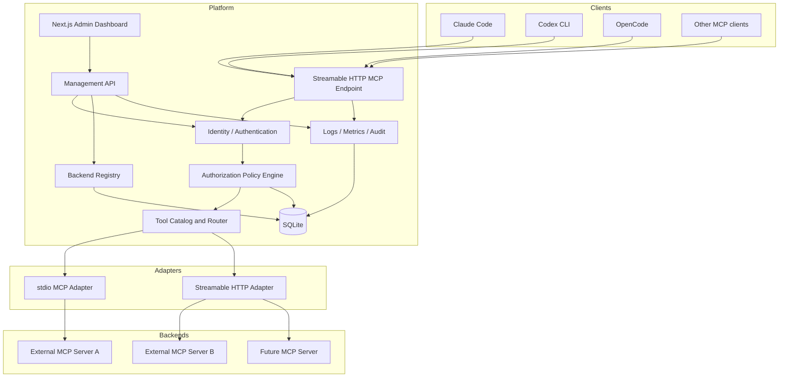

# System Architecture — Universal MCP Gateway

## 1. Principles

- Generic MCP gateway; no backend-specific core.
- Official MCP SDK for protocol implementation.
- Empty production registry by default.
- Dynamic backend configuration.
- Least-privilege authorization.
- Isolated sessions and scoped concurrency.
- Local-only network binding by default.
- Dashboard consumes documented backend APIs; it does not contain business logic.

## 2. Logical architecture



## 3. Deployment topology

Initial local deployment:
- Gateway/API process in WSL2.
- Dashboard served locally by Next.js, either same origin through a reverse proxy or a documented separate local port.
- SQLite database in project/runtime data directory, excluded from source control.
- Backend child processes launched by the gateway process when stdio adapters are enabled.
- Bind to loopback only.

Do not assume Windows and WSL share identical localhost routing or filesystem paths. Validate cross-environment access before connecting Windows desktop applications.

## 4. Application modules

Suggested source boundaries:

```text
src/
  adapters/
    mcp/
      stdio/
      streamable-http/
    process/
  api/
    routes/
    middleware/
  config/
  core/
    lifecycle/
    gateway/
  registry/
    domain/
    repositories/
    migrations/
  routing/
    catalog/
    dispatcher/
    namespacing/
  security/
    authentication/
    authorization/
    secrets/
    redaction/
  sessions/
  concurrency/
  monitoring/
    logging/
    metrics/
    health/
    audit/
  shared/
    errors/
    schemas/
    types/

apps/
  dashboard/
    app/
    components/
    features/
    lib/
```

This is a target structure, not a requirement to move existing files immediately. Preserve the current working bootstrap and refactor incrementally.

## 5. Inbound MCP lifecycle

1. Client connects to `/mcp`.
2. Transport validates HTTP request and host/origin according to SDK guidance.
3. Client identity is authenticated.
4. MCP initialize lifecycle is handled by official SDK.
5. The server establishes the selected stateless/sessionful behavior.
6. `tools/list` obtains the catalog filtered by the authenticated agent's policy.
7. `tools/call` checks identity, permission, schema, timeout, and concurrency.
8. Router dispatches to the correct backend adapter.
9. Adapter returns MCP-compatible result/error.
10. Observability records safe metadata and correlation ID.
11. Session/transport resources are cleaned up according to SDK lifecycle.

## 6. Outbound adapter lifecycle

Adapter interface should cover:
- validate configuration
- connect/start
- initialize MCP client
- list tools
- call tool
- health/status
- reconnect
- close/stop
- expose sanitized diagnostics

Use official MCP Client SDK. Keep process launch and transport details inside adapters. A backend failure must not crash the whole gateway.

## 7. Registry model

Backend definition fields (conceptual):
- `id`
- `name`
- `description`
- `transport`
- transport-specific connection config
- `enabled`
- `timeoutMs`
- `concurrencyPolicy`
- `createdAt`
- `updatedAt`

Runtime state should be separate:
- `status`
- `lastConnectedAt`
- `lastHealthCheckAt`
- `lastErrorCode`
- `lastErrorAt`
- `reconnectAttempt`

Do not store plaintext secrets in ordinary registry JSON/YAML or database columns. Use secret references and a separately designed secure store.

## 8. Tool catalog and naming

Proposed public tool name: `<backend_id>__<original_tool_name>`. Validate compatibility and length constraints before final adoption.

Catalog record:
- public tool name
- original tool name
- backend ID
- description
- input schema
- discovered timestamp
- enabled/visibility status

Collision must be explicit and fail closed. Never route a duplicate name based on ordering.

## 9. Authentication and authorization

Separate:
- Dashboard user identity.
- MCP client/agent identity.
- Backend credentials.

Use separate credential scopes. Dashboard login must not implicitly grant MCP tool access. MCP client metadata must not be trusted as identity.

Policy evaluation:
1. Authenticate caller.
2. Resolve active agent profile.
3. Load effective policy.
4. Filter tools/list.
5. Re-check permission on every tools/call.
6. Audit allow/deny outcome without recording secrets or sensitive payloads.

Default deny for unknown identities and unassigned tools.

## 10. Session isolation

Document and test selected Streamable HTTP session behavior against the installed SDK version. Keep session-bound data isolated. Define expiration, cleanup, and revocation. Avoid sharing mutable server/transport state between clients unless explicitly supported by the SDK lifecycle.

## 11. Concurrency

Per-backend/resource modes:
- `parallel`
- `serialized`
- `limited`

Use scoped queues/locks for stateful resources. Include timeout, cancellation, cleanup, and stale lock handling. Do not globally serialize all tool calls.

## 12. Data persistence

SQLite stores registry metadata, agent profiles, policy records, audit events, and any bounded operational metadata. Use migrations and repository interfaces. Runtime MCP client/transport/process objects stay in memory.

Define retention and backup policy. Do not store sensitive tool arguments/results by default.

## 13. Dashboard architecture

- Next.js application.
- Astryx as the direct UI component library and design system.
- Typed API client generated or maintained from backend API contracts.
- Feature-oriented page modules.
- Server-side authorization for protected dashboard routes and APIs.
- Loading, empty, error, and confirmation states.
- No business rules implemented only in the browser.

**Explicit exclusion:** no shadcn/ui, no Radix UI fallback component library, and no parallel design system. Follow the current Astryx official installation/API documentation. Do not guess package names or CLI commands.

## 14. Security boundaries

- Loopback binding by default.
- Authentication before protected operations.
- Authorization on every management API and MCP tool invocation.
- Origin/Host validation.
- Redacted logs.
- Safe stdio process launch with executable and argument arrays.
- Controlled environment inheritance.
- No arbitrary shell command interpolation.
- No public exposure before security review.

## 15. Error taxonomy

Internal categories:
- invalid request
- unsupported protocol operation
- unauthenticated
- forbidden
- unknown tool
- backend disabled
- backend unavailable
- backend timeout
- backend protocol error
- concurrency timeout
- internal gateway error

Return protocol-appropriate errors without leaking stack traces, secrets, process environment, or filesystem details.
