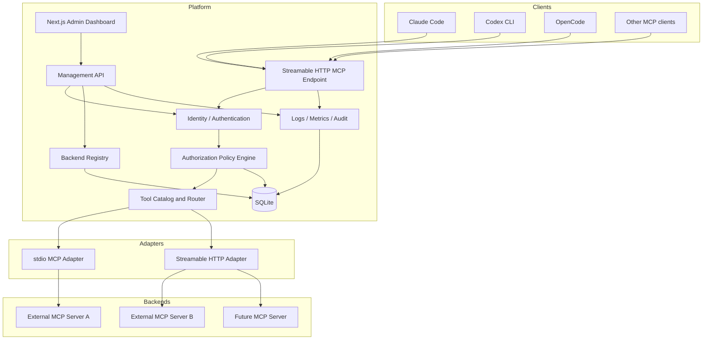

# System Architecture — Universal MCP Gateway

## 1. Principles

- Generic MCP gateway; no backend-specific core.
- Official MCP SDK for protocol implementation.
- Empty production registry by default.
- Dynamic backend configuration.
- Least-privilege authorization.
- Isolated sessions and scoped concurrency.
- Local-only network binding by default.
- Dashboard consumes documented backend APIs; it does not contain business logic.

## 2. Logical architecture



## 3. Deployment topology

Initial local deployment:
- Gateway/API process in WSL2.
- Dashboard served locally by Next.js, either same origin through a reverse proxy or a documented separate local port.
- SQLite database in project/runtime data directory, excluded from source control.
- Backend child processes launched by the gateway process when stdio adapters are enabled.
- Bind to loopback only.

Do not assume Windows and WSL share identical localhost routing or filesystem paths. Validate cross-environment access before connecting Windows desktop applications.

## 4. Application modules

Suggested source boundaries:

```text
src/
  adapters/
    mcp/
      stdio/
      streamable-http/
    process/
  api/
    routes/
    middleware/
  config/
  core/
    lifecycle/
    gateway/
  registry/
    domain/
    repositories/
    migrations/
  routing/
    catalog/
    dispatcher/
    namespacing/
  security/
    authentication/
    authorization/
    secrets/
    redaction/
  sessions/
  concurrency/
  monitoring/
    logging/
    metrics/
    health/
    audit/
  shared/
    errors/
    schemas/
    types/

apps/
  dashboard/
    app/
    components/
    features/
    lib/
```

This is a target structure, not a requirement to move existing files immediately. Preserve the current working bootstrap and refactor incrementally.

### 4.1 Implemented module layout (Phase 4)

```text
src/
  domain/          # contracts, no infrastructure imports
    primitives.ts        ids, timestamps, secret references
    backend.ts           definition + create/update schemas
    backend-runtime.ts   runtime state, status enum, BACKEND_TRANSITIONS
    agent.ts
    agent-credential.ts  verifier hash, derived status
    policy.ts            rules, effects, deterministic ordering
    session.ts
    activity-event.ts    operational history
    audit-event.ts       administrative/security history
    repositories.ts      persistence interfaces (SQL/persistence-free)
  shared/
    errors.ts        AppError, ErrorCode, toAppError, log view
    service.ts       SERVICE_INFO, so routing can name the gateway
  config/
    config.ts        pure parseConfig/loadConfig/redactConfig
  security/
    network-policy.ts    outbound destination policy (SSRF), guardedFetch
  adapters/
    adapter.ts           BackendAdapter interface + createAdapter()
    stdio-adapter.ts     child-process transport
    http-adapter.ts      Streamable HTTP transport
    mcp-client.ts        SDK Client wrapper, error normalization
    lifecycle.ts         BackendLifecycleManager — sole owner of live connections
  routing/         # Phase 5: discovery → catalog → route
    namespacing.ts       publicToolName, normalization, length bound
    schema.ts            remote JSON Schema → AJV validator (cached)
    catalog.ts           in-memory authoritative catalog, collision policy
    discovery.ts         discovery, coalescing, lifecycle observer
    router.ts            public name → backend call (timeout, cancel, audit)
    mcp-server.ts        tools/list + tools/call on the low-level SDK Server
  api/
    index.ts             management API assembly + middleware order
    http.ts              request id, envelopes, JSON parsing, error boundary
    middleware/
      guards.ts          loopbackOnly, requireJsonBody
    schemas/
      queries.ts         pagination/filter/param contracts
    routes/
      system.routes.ts
      backends.routes.ts
      tools.routes.ts    catalog, discovery reports, conflicts, refresh
  registry/
    backend-service.ts   business rules, transactions, audit, sanitization
  core/
    gateway.ts       Hono app + MCP handler + health + API mount + lifecycle
  infrastructure/
    database/
      connection.ts        pragmas, one handle per process
      migration-runner.ts  transactional, checksummed migrations
      migrations/0001_initial_schema.sql
      migrations/0002_backend_version.sql
      migrations/0003_runtime_disconnecting.sql
      repositories/        SQLite implementations
  monitoring/
    logger.ts        Pino + redaction paths
  index.ts           process lifecycle
```

Dependency direction is one-way: `index` → `core` → `api` → `registry` → `infrastructure`/`config` → `shared`/`domain`. `domain` imports only Zod and its own primitives, so it can move into a workspace package without changes (ADR-022). `registry` is the only layer that combines several repositories in one transaction.

Boundaries that matter:

- **Domain vs persistence.** Repository interfaces live in `src/domain/repositories.ts` and speak in entities; SQL and `better-sqlite3` types never appear there. An in-memory fake satisfies the same contract.
- **Route vs service vs repository.** A route parses HTTP and formats the response; `BackendService` owns uniqueness, transactions, audit, and sanitization; repositories own SQL. No handler contains a statement or a business rule.
- **Definition vs runtime.** `backends` holds configuration; `backend_runtime` holds observed connection state. A persisted backend never implies a live connection. Live objects (child processes, HTTP clients) live only in the lifecycle manager, never in either table.
- **Service vs lifecycle.** `BackendService` is synchronous and owns no connections. After a mutating transaction commits, the route calls `lifecycle.reconcile(id)` once: the manager re-reads the committed row, compares a connection fingerprint, and decides what the change means for live state (ADR-034). The service never spawns or dials.
- **Who owns the manager.** One `BackendLifecycleManager` per process, constructed in `createGateway()` and passed to the management API, so `connect` routes, `runtime` reads, startup `recover()`, and `shutdown()` all see the same connections. It is injectable for tests.
- **Activity vs audit.** Separate entities, tables, and interfaces. Operational volume must not dilute administrative history, and audit is append-only.
- **Contracts vs secrets.** Agent tokens are not part of the `Agent` entity; only a verifier hash is stored. Backend `env`/`headers` accept secret *references* only.

### 4.2 Management API middleware order (Phase 3)

Declared once in `createManagementApi()`, applied to every `/api/v1` route:

1. `requestId` — assigns or accepts a well-formed `X-Request-Id` so later log lines and error envelopes correlate.
2. `loopbackOnly` — rejects a non-loopback socket, a non-loopback configured `HOST`, a foreign `Host`, and a foreign `Origin`.
3. `jsonBodyLimit` — bounds the body before any parse allocates it.
4. `requireJsonBody` — rejects a declared non-JSON content type, which blocks cross-site form posts.

Order is load-bearing: the local-only check runs before a body is read, so a non-local caller cannot make the gateway buffer a payload. Host/Origin checks reuse the SDK's own `validateHostHeader`/`validateOriginHeader`; only the response envelope differs from `/mcp` (ADR-029).

The MCP surface keeps the SDK's `hostHeaderValidation`/`originValidation` middleware because a JSON-RPC client expects a JSON-RPC error. Both middlewares are scoped away from `/api/v1` so neither surface answers in the other's shape.

The API is not mounted at all when no store is configured, rather than mounted against a missing database.

## 4.3 Outbound connection lifecycle (Phase 4)

`src/adapters/lifecycle.ts` is the only place a backend is spawned or dialled. `docs/BACKEND_SPEC.md` §6.1 is the method-by-method contract; the architecture points are:

- **Serialized per backend.** Each backend gets one promise chain, so two concurrent `connect` calls open one connection, not two.
- **Explicit only.** Create, update, `enable`, and process start never connect. `enable` makes a backend eligible; `disable` cancels a pending retry and tears the connection down.
- **Recovery is safe, not eager.** On start, any persisted `connected`/`connecting`/`unhealthy`/`disconnecting` is a claim by a dead process. `recover()` rewrites it to `disconnected` (or `disabled`) and does not dial. A persisted `error` is preserved.
- **State machine enforced at the write.** `BACKEND_TRANSITIONS` declares every legal edge and `persist()` refuses anything else, so an impossible status cannot reach the table.
- **Backoff is bounded and jittered.** `initialDelay * 2^(n-1)`, capped, ± `jitterRatio`, at most `maxAttempts`. Only `BACKEND_TIMEOUT` and `BACKEND_UNAVAILABLE` retry; a bad executable, a policy refusal, or a rejected credential is permanent. Off by default (`RECONNECT_ENABLED=false`).
- **Shutdown order.** `Gateway.close()` closes the MCP handler, then awaits `lifecycle.shutdown()`, then the caller closes the store — so a teardown can still write a truthful runtime row.
- **Destination policy before the socket.** `src/security/network-policy.ts` validates scheme, credentials, and every DNS-resolved address, and wraps `fetch` so the check runs per request (SSRF; `docs/SECURITY.md` §3.2).

`docs/BACKEND_SPEC.md` §6 describes the transports; `tests/lifecycle.test.ts` and `tests/lifecycle-api.test.ts` exercise them against isolated fixtures only.

## 4.4 Tool discovery and routing (Phase 5)

`src/routing/` is one pipeline with four separable pieces; each file has one job and can be read alone.

- **`namespacing.ts` — identity.** `publicToolName(backendId, originalName)` joins two normalized segments with `__`. Normalization replaces every character outside `[A-Za-z0-9._-]` with `_`; a name longer than 128 characters is cut and suffixed with `__<8 hex>` derived from `SHA-256(backendId, NUL, originalName)`. Same inputs, same name, always (ADR-036).
- **`catalog.ts` — truth.** The catalog is in memory and authoritative. It holds one snapshot per backend (tools keyed by original name) plus an index from public name to owner. Collisions are computed at read time from the whole index, and **every** claimant is withheld rather than routing by discovery order. Nothing is persisted: a catalog row on disk would be a claim about a connection that a restart cannot honour (ADR-038).
- **`discovery.ts` — acquisition.** Calls `tools/list`, validates metadata, builds the snapshot, and swaps it atomically. Concurrent discoveries for one backend coalesce onto one request. A listing that fails leaves the previous snapshot untouched but does not resurrect it after a disconnect — the lifecycle observer removes the backend entirely, so a stale map cannot outlive its connection.
- **`router.ts` — dispatch.** Resolves at call time, re-checks runtime truth (`enabled`, `connected`), validates arguments against the backend's own schema, then calls the owning client. The timeout is `min(toolCallTimeoutMs, backend.timeoutMs)` so a backend's configured budget is never widened. Cancellation is classified from `context.signal.aborted`, not from the error's shape.

`mcp-server.ts` projects a catalog tool into the protocol payload. Its only assertion — `Tool[]` — is justified because `toDefinition` has already validated the shape; the alternative is rebuilding every remote schema in Zod, which would lose `$defs`, vendor extensions, and formats (ADR-037).

The catalog is served through a **low-level `Server`**, not `McpServer`: `McpServer.registerTool` binds its request handlers once at construction, which cannot describe a catalog that changes during the process's life. One server instance is created per exchange and holds no state.

**Lifecycle coupling.** The manager exposes `setConnectionObserver()`; discovery registers an observer that fires on connect and disconnect. The setter (rather than a constructor argument) breaks the mutual reference, and the observer is fire-and-forget so an observer bug can never fail a connect or block a teardown. `activeClient(backendId)` returns a client only when the runtime status is exactly `connected`, resolved per call and never cached.

## 5. Inbound MCP lifecycle

1. Client connects to `/mcp`.
2. Transport validates HTTP request and host/origin according to SDK guidance.
3. Client identity is authenticated — **not yet implemented** (Phase 6); today the loopback bind is the only control.
4. MCP initialize lifecycle is handled by official SDK.
5. The server establishes the selected stateless/sessionful behavior.
6. `tools/list` reads the in-memory catalog: only tools from connected, enabled backends, with colliding names withheld. Full list, no pagination (protocol-legal; the catalog is bounded at 2000 tools per backend).
7. `tools/call` resolves the public name, re-checks runtime truth, validates arguments against the backend's own JSON Schema, and applies the call timeout.
8. `ToolRouter` dispatches to the owning backend through the lifecycle's `activeClient`. A cancelled request is classified from the transport's abort signal.
9. Adapter returns MCP-compatible result/error. A backend tool-level failure is a `CallToolResult` with `isError`, never a protocol error; routing failures map onto JSON-RPC codes (`-32602` unknown/invalid, `-32800` cancelled, `-32603` otherwise).
10. Observability records safe metadata and correlation ID: `tools.list`/`tools.call` activity with backend, public name, outcome, error code, duration — no arguments or results.
11. Session/transport resources are cleaned up according to SDK lifecycle.

## 6. Outbound adapter lifecycle

Implemented in Phase 4 (`src/adapters/`, `docs/BACKEND_SPEC.md` §5–6). The adapter interface is deliberately narrow: connect to the official MCP Client SDK client, close, and expose a loggable target. Lifecycle, retry, health, and state persistence belong to the manager, so adding a transport does not mean reimplementing them.

`McpBackendClient` wraps the SDK `Client` to normalize SDK/transport/OS failures onto the gateway's `AppError` taxonomy and own the per-call timeout. It walks the error's cause chain, so a wrapped `ECONNREFUSED` is still recognized as transient and a wrapped policy refusal still surfaces its real message.

A backend failure never crashes the gateway: `connect` rejects with a mapped error, the runtime row records a sanitized code, and the process stays up. See §4.3 for ownership and recovery.

## 7. Registry model

Implemented in Phase 3 (`src/domain/backend.ts`, `src/registry/backend-service.ts`, `docs/BACKEND_SPEC.md`).

Backend definition fields:
- `id` — application-generated UUIDv4.
- `name` — unique among active backends (`RESOURCE_CONFLICT` on clash).
- `description` — optional, nullable.
- `connection` — discriminated union on `type`: `stdio` or `streamable-http`.
- `enabled` — configuration flag only; not a connection.
- `timeoutMs` — per-call timeout applied later by an adapter.
- `concurrencyMode` / `concurrencyLimit` — `parallel` | `serialized` | `limited`.
- `version` — optimistic-concurrency counter, incremented on every persisted change.
- `createdAt`, `updatedAt`.

Runtime state is a separate row and never part of a definition:
- `status` — `disconnected` | `connecting` | `connected` | `unhealthy` | `disconnecting` | `error` | `disabled`.
- `lastConnectedAt`, `lastHealthCheckAt`, `lastErrorCode`, `lastErrorAt`, `reconnectAttempts`.

Rules enforced by the registry service:

- Creating, updating, enabling, or disabling **cannot** connect, spawn, or resolve anything. Only two configuration-visible runtime transitions exist: disable → `disabled`, enable from `disabled` → `disconnected`. A `connected` state is never fabricated.
- A definition's `env`/`headers` may hold secret *references* (`secret:...`, `env:VAR`) only. A literal secret is rejected by the schema, so an API response cannot leak one by construction.
- A stdio `command` is a single executable token. Arguments, flags, and pipes belong in `args`; a shell-looking command is rejected rather than split.
- Deletion is a tombstone: the backend leaves the registry, runtime state cascades, and audit rows keep referencing the id.

Do not store plaintext secrets in ordinary registry JSON/YAML or database columns. Use secret references and a separately designed secure store.

## 8. Tool catalog and naming

Implemented in Phase 5 (`src/routing/`, ADR-036/037/038). Public name:
`<normalized_backend_id>__<normalized_original_tool_name>`.

Normalization is total and deterministic: every character outside
`[A-Za-z0-9._-]` becomes `_`, so `search items` and `search_items` produce the
same public name and therefore genuinely collide. Names over 128 characters are
cut and suffixed with `__<8 hex of SHA-256(backendId NUL originalName)>` — the
suffix is derived from identity, never random, so the same tool keeps the same
name across restarts and rediscoveries.

Catalog record (`src/domain/tool.ts`):

- public name, original name, backend ID
- description, input schema (the backend's own JSON Schema, forwarded verbatim)
- availability: `available` | `unavailable` | `conflict` | `rejected`
- discovery/update timestamps

**Collision must be explicit and fail closed.** Every claimant of a colliding
public name is withheld; no first-writer-wins, no last-wins. Within one backend,
two originals that normalize to one name keep the first and mark the rest
`rejected` with the reason, so the report says what happened. Conflicts are
recomputed from the whole index on every read, so a backend disconnecting
releases the names it was blocking.

Nothing is persisted: the catalog is derived state, rebuilt by rediscovery. A
stored catalog would outlive the connection it described, which is the exact
staleness the spec forbids.

## 9. Authentication and authorization

Separate:
- Dashboard user identity.
- MCP client/agent identity.
- Backend credentials.

Use separate credential scopes. Dashboard login must not implicitly grant MCP tool access. MCP client metadata must not be trusted as identity.

Policy evaluation:
1. Authenticate caller.
2. Resolve active agent profile.
3. Load effective policy.
4. Filter tools/list.
5. Re-check permission on every tools/call.
6. Audit allow/deny outcome without recording secrets or sensitive payloads.

Default deny for unknown identities and unassigned tools.

## 10. Session isolation

Document and test selected Streamable HTTP session behavior against the installed SDK version. Keep session-bound data isolated. Define expiration, cleanup, and revocation. Avoid sharing mutable server/transport state between clients unless explicitly supported by the SDK lifecycle.

**Current (Phase 1):** serving is stateless per HTTP exchange. `createMcpHandler` builds a fresh `McpServer` from a factory for every exchange, so no mutable state exists to share; `tools/list` and `tools/call` see only that exchange's instance. Session ids are not issued and a client-supplied `mcp-session-id` is ignored. `GET`/`DELETE` answer `405` on the stateless legacy leg.

**Deferred to Phase 7:** server-side session registry, expiry/revocation, resumable streams, and per-session concurrency accounting. Until then a session cannot be revoked mid-flight because none is tracked — credential revocation (Phase 6) is enforced per request instead.

## 11. Concurrency

Per-backend/resource modes:
- `parallel`
- `serialized`
- `limited`

Use scoped queues/locks for stateful resources. Include timeout, cancellation, cleanup, and stale lock handling. Do not globally serialize all tool calls.

## 12. Data persistence

SQLite stores registry metadata, agent profiles, policy records, audit events, and any bounded operational metadata. Access goes through the repository interfaces in `src/domain/repositories.ts`; SQL is confined to `src/infrastructure/database/`. Runtime MCP client/transport/process objects stay in memory.

Implemented in Phase 2 (details in `docs/DATABASE.md`):

- One connection per process, WAL + `synchronous=FULL` + `foreign_keys=ON`.
- Transactional, checksummed, additive migrations; applied files are immutable.
- Soft delete (tombstone) for backends and agents; hard delete with cascade for policies; revocation timestamps for credentials and sessions.
- Status for credentials and sessions is derived from timestamps, not stored.

Retention and backup policy are still to be defined. Do not store sensitive tool arguments/results by default.

## 13. Dashboard architecture

- Next.js application.
- Astryx as the direct UI component library and design system.
- Typed API client generated or maintained from backend API contracts.
- Feature-oriented page modules.
- Server-side authorization for protected dashboard routes and APIs.
- Loading, empty, error, and confirmation states.
- No business rules implemented only in the browser.

**Explicit exclusion:** no shadcn/ui, no Radix UI fallback component library, and no parallel design system. Follow the current Astryx official installation/API documentation. Do not guess package names or CLI commands.

## 14. Security boundaries

- Loopback binding by default; a non-loopback `HOST` is refused at config load.
- The management API is **unauthenticated** in Phase 4. Its boundary is local-only access (socket address, `HOST`, `Host`, `Origin`) plus a JSON content-type requirement — not identity. Since Phase 4 a local caller can also cause a process spawn and an outbound connection, so the blast radius is larger than in Phase 3. Do not expose it via tunnel, proxy, or non-loopback bind before Phase 6.
- Outbound Streamable HTTP destinations pass a documented policy: `http`/`https` only, no embedded credentials, DNS-resolved address classification, per-request re-check, same-origin redirects. `ALLOW_PRIVATE_NETWORK` opens loopback/private/CGNAT for local fixtures and never metadata or link-local.
- Registration, enable, and process start never connect; a connection requires an explicit `connect`, and a restart rewrites persisted live state to `disconnected` without reconnecting.
- Origin/Host validation on both surfaces, each answering in its own protocol's error shape.
- Redacted logs; secrets exist only as references, so there is nothing to redact in a payload.
- Safe stdio process launch with executable and argument arrays; no shell interpolation.
- Controlled environment inheritance (SDK default set plus explicitly referenced variables).
- No public exposure before security review.

## 15. Error taxonomy

Implemented in `src/shared/errors.ts` as `AppError` with stable `ErrorCode` values. Each code has a fixed category, HTTP status, and JSON-RPC code (`errorDefinition()`), so mapping is a table lookup rather than per-call judgement.

| Code | Category | HTTP | JSON-RPC |
| --- | --- | --- | --- |
| `VALIDATION_ERROR` | client | 400 | -32602 |
| `RESOURCE_NOT_FOUND` | client | 404 | -32602 |
| `RESOURCE_CONFLICT` | client | 409 | -32602 |
| `MCP_PROTOCOL_ERROR` | client | 400 | -32600 |
| `AUTHENTICATION_ERROR` | denied | 401 | -32001 |
| `AUTHORIZATION_ERROR` | denied | 403 | -32002 |
| `BACKEND_CONNECTION_ERROR` | unavailable | 502 | -32603 |
| `BACKEND_UNAVAILABLE` | unavailable | 503 | -32603 |
| `BACKEND_TIMEOUT` | unavailable | 504 | -32603 |
| `CONFIGURATION_ERROR` | internal | 500 | -32603 |
| `DATABASE_ERROR` | internal | 500 | -32603 |
| `INTERNAL_ERROR` | internal | 500 | -32603 |

Rules:

- `message` is client-safe; `details` and `cause` are log-only and never serialized outward (`toEnvelope()`).
- `toAppError()` collapses any non-`AppError` into `INTERNAL_ERROR` with a generic message, preserving the original as `cause`, so raw SQLite/OS text cannot reach a client. The one exception is a `ZodError`: it is always malformed caller input, so it maps to `VALIDATION_ERROR` naming only the failing paths and messages — never the received values.
- `describeErrorForLog()` is the only view that includes stacks and causes.
- `isClientFault()` separates caller mistakes from gateway faults so invalid input is not logged as an outage.

Return protocol-appropriate errors without leaking stack traces, secrets, process environment, or filesystem details.
